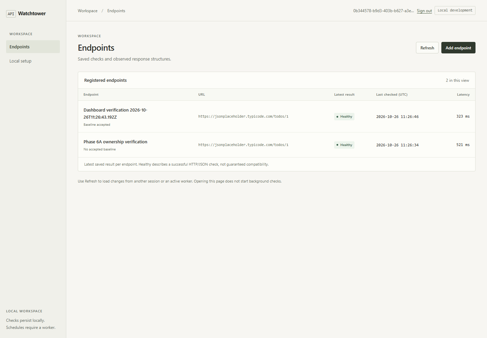
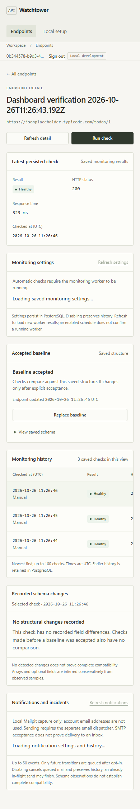
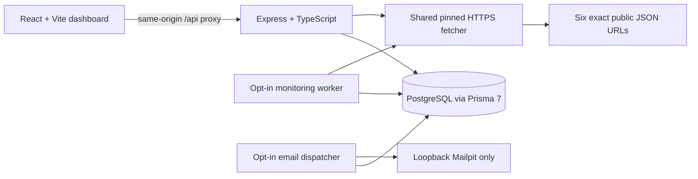

# API Watchtower

API Watchtower is a local-first API monitoring dashboard. Register one of six reviewed public JSON endpoints, run real HTTPS checks, accept a structural baseline explicitly, and inspect later response-schema changes and monitoring history.

This repository is a **portfolio-ready local release candidate**, not a hosted service. The API binds to loopback, management requires explicit development opt-in, and arbitrary domains and external email are not supported.

## GitHub Pages portfolio demo

After this repository is pushed and GitHub Pages is enabled with **GitHub Actions** as its source, the frontend-only portfolio demonstration will be available at:

`https://<GITHUB-USERNAME>.github.io/api-watchtower/`

The Pages build uses a separate **Demo Mode** entry path. It displays illustrative endpoint results, histories, schema differences, schedules, and notification records; it makes no API requests, has no login or write controls, and connects to no database or mail service. The normal local application remains the default for development builds.

The workflow at `.github/workflows/pages-demo.yml` builds with the `/api-watchtower/` base path and publishes only when the pushed branch matches the repository's configured default branch. It does not enable Pages or publish until you push the reviewed changes and configure Pages in repository settings.

To preview the same static demo locally:

```powershell
$env:VITE_DEMO_MODE = 'true'
$env:VITE_BASE_PATH = '/api-watchtower/'
$env:VITE_REPOSITORY_URL = 'https://github.com/<GITHUB-USERNAME>/api-watchtower'
npm run dev -w @watchtower/web -- --host 127.0.0.1
```

Open <http://127.0.0.1:5173/api-watchtower/>. This runs the frontend only. The project Pages build itself is produced with `npm run build -w @watchtower/web` in the GitHub Actions workflow using the same base path.

To publish after review, push the changes to the repository's default branch, then open **Settings → Pages** and select **GitHub Actions** under Build and deployment. GitHub will provide the exact Pages URL after the workflow completes. Replace the placeholder link above with that URL when known.

## Screenshots

These are genuine screenshots captured from the local React application during browser verification. Results shown are real saved checks from that run; they are not sample data loaded into the app.





## What works

- Local account registration and login with Argon2id passwords, HttpOnly server-side sessions, CSRF protection, and endpoint ownership isolation.
- Endpoint registration through a provider-grouped selector. The only supported URLs are:

  - JSONPlaceholder: `https://jsonplaceholder.typicode.com/todos/1`
  - JSONPlaceholder: `https://jsonplaceholder.typicode.com/posts/1`
  - JSONPlaceholder: `https://jsonplaceholder.typicode.com/users/1`
  - JSONPlaceholder: `https://jsonplaceholder.typicode.com/posts/1/comments`
  - GOV.UK: `https://www.gov.uk/bank-holidays.json`
  - DummyJSON: `https://dummyjson.com/products/categories`

- Manually requested HTTPS GET checks with exact URL validation, public IPv4 DNS validation and socket pinning, peer verification, hostname-aware TLS validation, no redirects, and bounded response size, duration, JSON complexity, and concurrency.
- PostgreSQL history, explicit baseline acceptance/replacement, deterministic JSON structure comparison, and field-level change paths. No full response bodies are stored.
- Opt-in 5, 15, 30, or 60 minute schedules in a separate monitoring worker. A saved schedule is not evidence that the worker is running.
- Deduplicated incident transitions and PostgreSQL outbox/retry history. Email capture is restricted to local Mailpit and `.test` recipients; SMTP acceptance is not inbox delivery.
- Responsive dashboard states for missing baselines, empty history, loading, errors, saved schedules, incidents, and notification history.

## Architecture



The API, independent worker, and email dispatcher reuse the same TypeScript service/repositories and PostgreSQL coordination. Vite proxies `/api` during local development. The production security architecture has not been implemented.

## Requirements

- Node.js 22.12 or newer and npm 10 or newer.
- A local PostgreSQL server at `127.0.0.1:5432` with the already migrated `watchtower_dev` database. For a fresh machine, see [database setup](docs/database.md).
- Mailpit is optional and only needed for local email-capture demonstrations.

## Install and launch

From PowerShell at the repository root:

```powershell
npm install
if (-not (Test-Path apps/api/.env)) { Copy-Item .env.example apps/api/.env }
```

Edit the ignored `apps/api/.env` with your own local PostgreSQL password and URL-encode special characters in the URL. Do not copy credentials into source files or screenshots. The existing databases already have all four migrations; **do not run initialization, migration, reset, or database preparation commands against them**.

In the same PowerShell window, start the frontend and API:

```powershell
$env:NODE_ENV = 'development'
$env:ENABLE_LOCAL_MANAGEMENT = 'true'
$env:AUTH_COOKIE_SECURE = 'false' # localhost HTTP development only
npm run dev
```

Open <http://localhost:5173>. The API process health route is <http://localhost:3001/api/health>; it checks process liveness, not database readiness. Stop the processes with Ctrl+C. The local HTTP cookie exception is not suitable for public hosting; Secure cookies remain the default outside the explicitly configured development exception.

See [the step-by-step local demonstration](docs/local-demo.md) for registration, real checks, baselines, schedule controls, and Mailpit capture.

## Development commands

| Command | Purpose |
| --- | --- |
| `npm run dev` | Start Vite and the local API |
| `npm run dev:worker` | Start the separately opted-in monitoring worker |
| `npm run dev:email` | Start the separately opted-in Mailpit dispatcher |
| `npm test` | Run backend and frontend unit/component tests; infrastructure-gated tests can skip |
| `npm run test:db` | Run PostgreSQL integration tests against `TEST_DATABASE_URL` only |
| `npm run test:e2e` | Run opt-in browser workflows against the local API and databases |
| `npm run typecheck` | TypeScript checks for both workspaces |
| `npm run build` | API and frontend production builds |
| `npm run db:validate` | Validate the Prisma schema without applying migrations |
| `npm run db:verify` | Run an actual `SELECT 1` against configured `DATABASE_URL` |

For database tests, configure `TEST_DATABASE_URL` to the separate local `watchtower_test` database and set `TEST_DATABASE_DISPOSABLE=true` only after confirming that target. The tests do not reset or truncate databases and clean up only their own fixture rows. Never point `TEST_DATABASE_URL` at `watchtower_dev`.

## Security and limitations

- Local development only. There is no approved public deployment configuration, production reverse-proxy contract, isolated egress firewall, or public account-registration policy.
- Only the six exact URLs above are accepted. No arbitrary host, URL path, query, custom header, credential, or redirect support. The proposed Nager.Holidays destination failed its preflight and is excluded.
- IPv6 outbound fetches are unsupported. DNS/socket pinning and TLS verification are defense in depth, not a network egress boundary.
- Monitoring is an observation from one request and one vantage point; a failed check does not prove a provider-wide outage. Schema inference from sampled arrays/optional fields is conservative and does not prove complete compatibility.
- Scheduling only runs while the separate worker is active. Email notifications are disabled by default and only captured by local Mailpit; real external delivery and recipient verification do not exist.
- Existing local databases contain real development history. Preserve them; do not reset, truncate, delete, or recreate them to prepare a demo.

## Project layout

- `apps/web`: React, Vite, TypeScript, Tailwind CSS, component and browser tests.
- `apps/api`: Express, TypeScript, Prisma, authentication, monitoring, scheduling, and notification processes.
- `apps/api/prisma`: PostgreSQL schema and the four approved migrations already applied to local development/test databases.
- `docs`: setup, API, security, scheduling, notification, and demonstration guides.
- `scripts`: guarded local PowerShell helpers.

## Next steps

The next meaningful engineering work is a production-runtime boundary and an isolated outbound-fetch boundary, followed by verified email/account lifecycle controls. Until those are designed, tested, and separately approved, keep this release local and keep the six-URL allowlist unchanged.
